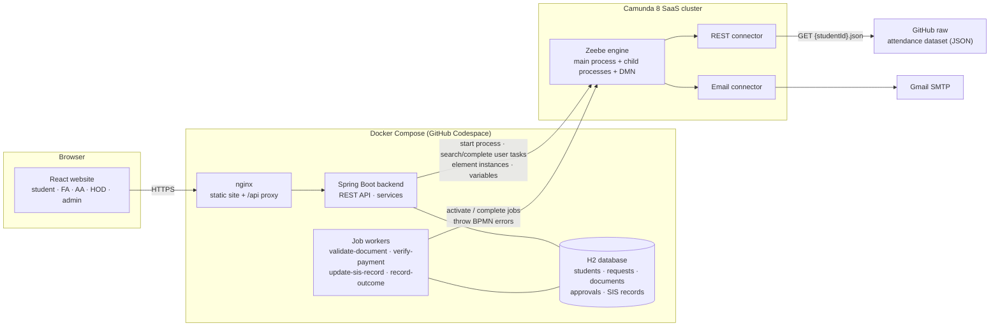

# Attendance Shortage Condonation

A full-stack workflow automation application built with **Camunda 8**, **Spring Boot**, **React** and an **H2** database.

## Project overview

Students need 75% attendance in a course to sit the end-semester exam. A student who falls short can apply for **condonation**: they explain why they were absent, attach supporting documents (medical certificate, OD letter …) and, if approved and the fee is paid, their shortage is condoned.

This project automates that process end to end:

1. A student logs in, picks a course below 75%, describes the reason and attaches documents (built with a **document array builder**).
2. The **Camunda 8** process fetches the student's attendance through a **REST connector**, computes the percentage and shortfall with **FEEL**, and a **DMN** decision table decides the slab and fee.
3. Each document is checked in parallel (**parallel multi-instance** job worker): a renamed text file posing as a PDF is caught here.
4. The request goes to the **Faculty Advisor → Academic Advisor → Head of Department**, each one a **Call Activity** to a reusable approval sub-process with a reminder timer.
5. The student pays the fee in a **sub-process** guarded by a **timer** (deadline) and an **error** boundary (invalid payment).
6. The Student Information System (SIS) is updated; a failure goes to the admin, who fixes it and the update is retried.
7. The student and all three approvers are e-mailed through the **Email connector** (approvers one after another: **sequential multi-instance**).

Every rejection path (student not found, not eligible, document rejected, FA/AA/HOD rejected, fee unpaid, payment invalid) sets a reason, e-mails the student and records the outcome.

The **React** website has one view per role: students submit and track requests on a live **route slip**; FA, AA, HOD and admin work from a **custom Tasklist inbox**.

| Role | Demo login | What they do |
|---|---|---|
| Student | `RA2311004010101` … `RA2311004010104` | Submit requests, follow the live status, pay the fee |
| Faculty Advisor | `fa` | First review |
| Academic Advisor | `aa` | Second review |
| Head of Department | `hod` | Final decision |
| Admin | `admin` | Fix failed SIS updates, toggle the simulated SIS failure |

All demo users share the password `demo123` (set by `DEMO_PASSWORD`).

## Repository structure

```
attendance-shortage-condonation/
├── bpmn-models/            Main BPMN, child BPMNs (Call Activities), DMN, Camunda Forms  → bpmn-models/README.md
├── backend-springboot/     Spring Boot: REST API, JPA entities, repositories, services, Zeebe job workers  → backend-springboot/README.md
├── frontend-react/         React + Vite + Tailwind: role-based views, document builder, Tasklist UI  → frontend-react/README.md
├── docker-compose.yml      Runs the backend and the website (nginx) together
├── .env.example            Every setting and secret the app reads (copy to .env)
├── .devcontainer/          GitHub Codespaces configuration (Docker-in-Docker)
└── .github/workflows/      CI: backend build + tests, frontend build, Docker stack smoke test
```

## Technology stack

| Layer | Technology |
|---|---|
| Process engine | **Camunda 8.10 SaaS** (Zeebe), Web Modeler, Operate, Tasklist |
| Process models | BPMN 2.0 (Call Activities, parallel + sequential multi-instance, sub-processes, error/timer boundary events, exclusive/parallel gateways), **DMN** decision table, **FEEL** expressions, Camunda Forms |
| Connectors | **REST connector** (`io.camunda:http-json:1`) for attendance data, **Email connector** (`io.camunda:email:1`, Gmail SMTP) |
| Backend | Java 21, **Spring Boot 3.5**, Spring Web, Spring Data JPA, Bean Validation, **Camunda Spring Boot starter 8.10** (`CamundaClient`, typed `@JobWorker`s, BPMN errors) |
| Database | **H2** (file mode, Docker volume) |
| Frontend | **React 19**, **Vite 7**, **Tailwind CSS 4**, React Router 7 |
| Packaging | **Docker** (multi-stage builds), **Docker Compose**, nginx reverse proxy |
| Hosting / dev | **GitHub Codespaces**, GitHub Actions CI |

## System architecture



**How a request flows through the system**

1. `POST /api/files` stores each document in H2; `POST /api/requests` saves the request and starts `attendance-shortage-condonation` with the student, course, reason and `documents` list as variables.
2. Camunda runs the connectors, script tasks and DMN itself; the four service tasks are executed by the Spring Boot **job workers**, which also write their results to H2.
3. The website's inbox calls `GET /api/tasks`, which searches Camunda user tasks by candidate group (`FA`, `AA`, `HOD`, `admin`) or assignee (the student). Completing a task (`POST /api/tasks/{key}/review`, `/pay-fee`, `/admin-fix`) completes the Camunda user task with typed variables.
4. The route slip polls `GET /api/requests/{id}/status`, which combines Camunda **element instances** (which step is active/completed/terminated), **process variables** (slab, fee, approvals, rejection reason) and the database.

### Process models

| File | ID | Contents |
|---|---|---|
| `condonation-main.bpmn` | `attendance-shortage-condonation` | Main flow (see below) |
| `approval-child.bpmn` | `condonation-approval` | One review: user task for the `approverRole` candidate group + non-interrupting reminder timer (`R3/` + `reminderInterval`) → `send-notification` |
| `notification-child.bpmn` | `send-notification` | Email connector; SMTP errors become `EMAIL_FAILED` and end the child quietly |
| `condonation-eligibility.dmn` | `condonation-eligibility` | Slab and fee by attendance % and reason |
| `forms/*.form` | `review-request`, `pay-fee`, `admin-fix` | Camunda Forms, so the same tasks also work in Camunda Tasklist |

```
Request submitted
→ Fetch attendance (REST connector) ──404──► error boundary STUDENT_NOT_FOUND ─┐
→ Calculate attendance & shortfall (FEEL script)                              │
→ Decide eligibility (DMN) → Condonable? ──no───────────────────────────────── ┤
→ [Sub-process] Verify documents: Validate document ×N (parallel MI)          │
                                   Summarise checks (FEEL)                    │
                 error boundary DOC_INVALID ───────────────────────────────── ┤
→ FA approval (Call Activity) → approved? ──no─────────────────────────────── ┤
→ AA approval (Call Activity) → approved? ──no─────────────────────────────── ┤
→ HOD approval (Call Activity) → approved? ──no────────────────────────────── ┤
→ [Sub-process] Fee payment: Pay fee (user task) → Verify payment (worker)   │
                 timer boundary feeDeadline ───────────────────────────────── ┤
                 error boundary PAYMENT_INVALID ───────────────────────────── ┤
→ Update SIS (worker) ──SIS_UPDATE_FAILED──► Admin fix (user task) ─► retry   │
→ Parallel: notify student · inform FA, AA, HOD (sequential MI) · record      │
→ Attendance condoned                                                         │
                                Rejection milestone (sets rejectionReason) ◄──┘
                                → Notify student → Record outcome → Request rejected
```

**Variable scoping.** Call activities pass `approverRole` in and copy only the child's `approval` result out (`propagateAllChildVariables = false`, output mapping to `faApproval` / `aaApproval` / `hodApproval`), so the three reviews never overwrite each other. The parallel multi-instance keeps `document` and `documentCheck` local to each instance and collects the results into `documentChecks`. Rejection milestones use output mappings to set `rejectionReason` / `rejectionStage` at process level. BPMN errors thrown by workers carry a note (`documentRejectionNote`, `paymentRejectionNote`, `sisError`). Camunda keeps error variables local to the catching boundary event, so each error boundary event has an output mapping that copies the note to the process scope, where the rejection message and the admin-fix form use it.

## Setup and execution

### Option A — GitHub Codespaces (recommended, nothing to install)

1. **Camunda (once):**
   - In Camunda Hub → Clusters → your cluster → **Connector secrets**, add `SMTP_USERNAME` (Gmail address) and `SMTP_PASSWORD` (a Gmail **app password**).
   - On the cluster's **API** tab, create a client with the **Orchestration Cluster API** scope and keep its client ID and secret.
2. On GitHub: **Code → Codespaces → Create codespace on main**. The container comes with Docker and creates `.env` from `.env.example`.
3. Open `.env` and fill in `CAMUNDA_CLIENT_ID`, `CAMUNDA_CLIENT_SECRET` (and optionally `NOTIFICATION_EMAIL` to receive every e-mail in your inbox). If your cluster is not the one in `.env.example`, also set `CAMUNDA_CLUSTER_ID` and `CAMUNDA_REGION`.
4. In the terminal:
   ```bash
   docker compose up --build -d
   docker compose logs -f backend     # wait for "Deployed to Camunda" and "Started CondonationApplication"
   ```
5. Open the **Ports** tab and click the globe icon next to port **3000** (Website). Log in with a demo account.

The backend deploys all BPMN, DMN and form files on startup, so the cluster does not need anything deployed by hand. Stop with `docker compose down` (data stays in the `backend-data` volume; add `-v` to reset it).

### Option B — any machine with Docker

```bash
git clone https://github.com/rsrk07/attendance-shortage-condonation.git
cd attendance-shortage-condonation
cp .env.example .env        # then fill in CAMUNDA_CLIENT_ID and CAMUNDA_CLIENT_SECRET
docker compose up --build
```
Website: <http://localhost:3000> · API: <http://localhost:8080/api>

### Option C — run without Docker (development)

```bash
# terminal 1 - backend (Java 21 + Maven)
cd backend-springboot
export $(grep -v '^#' ../.env | xargs)
mvn spring-boot:run

# terminal 2 - frontend (Node 22)
cd frontend-react
npm install
npm run dev                 # http://localhost:5173, /api is proxied to :8080
```

### Demo script

| # | Who | Do | What happens |
|---|---|---|---|
| 1 | `RA2311004010103` | New request → 21ECC302J (69.44%), Medical, attach a real PDF | Slab B, fee ₹1,000; document verified; FA task appears |
| 2 | `fa`, then `aa`, then `hod` | Inbox → Review → Approve | Stamps appear on the student's route slip one by one |
| 3 | student | Fee payments → pay ₹1,000, reference `UPI4829301756` | Payment verified → SIS updated → **Condoned** stamp; e-mails sent |
| 4 | `admin` | Settings → turn on *Simulate an SIS failure*, then repeat 1–3 for another course | "Fix the SIS update" lands in the admin inbox; fixing it retries and completes |
| 5 | student | Request for 21ECC303T of `RA2311004010104` (41.67%) | DMN says not eligible → rejected with the reason, e-mail sent |
| 6 | student | Attach a text file renamed to `.pdf` | `validate-document` throws `DOC_INVALID` → rejected at document verification |
| 7 | approver | Reject with a remark | Rejection reason shows the remark; later approvers are skipped |

Processes can also be followed in **Camunda Operate** and the user tasks completed in **Camunda Tasklist** (Camunda Forms).

### Automated tests

| Test | Where | What it covers |
|---|---|---|
| Unit tests | `backend-springboot/src/test` (`mvn package`) | Document signature checks, payment rules, file-name cleaning |
| API smoke test | `.github/scripts/smoke-test.sh` (CI, against the jar and against the Docker stack through nginx) | Login, roles (401/403), seeding, upload validation, request validation, rollback when Camunda is unreachable |
| End-to-end test | `scripts/e2e-test.sh` (against the running stack and the real Camunda cluster) | The seven scenarios below |

```bash
# needs a fresh database, so start from an empty volume:
docker compose down -v && docker compose up -d     # wait ~30 s for the backend
docker run --rm --network host -v "$PWD/scripts:/scripts" alpine:3.20 \
  sh -c "apk add -q bash curl jq && bash /scripts/e2e-test.sh"
```

| # | Scenario | Expected |
|---|---|---|
| 1 | `RA2311004010103`, 21ECC302J (69.44%), medical, real PDF; FA, AA, HOD approve; pays ₹1,000 | Approved, Slab B, document verified, three approvals, SIS record written |
| 2 | `RA2311004010104`, 21ECC303T (41.67%) | Rejected at eligibility (DMN: not eligible) |
| 3 | `RA2311004010102`, 21ECC301T, text file renamed to `.pdf` | Rejected at document verification, with the worker's reason |
| 4 | `RA2311004010103`, 21ECC303T, FA rejects with a remark | Rejected at FA review; AA, HOD, fee and SIS skipped |
| 5 | `RA2311004010101`, 21ECC302J, pays ₹100 of ₹1,000 | Rejected at fee payment (`PAYMENT_INVALID`), with the worker's reason |
| 6 | `RA2311004010101`, 21ECC301T (72.22%) with the simulated SIS failure on | Admin gets "Fix the SIS update", fixes it, update retried → approved (Slab A) |
| 7 | `RA2311004010103` applies again for the condoned 21ECC302J | Refused with 409; the course shows as condoned |

## FEEL expression dictionary

All expressions as used in `bpmn-models/` (main process unless noted).

### Data and calculations

| Where | Expression | Purpose |
|---|---|---|
| Fetch attendance → `url` | `"https://raw.githubusercontent.com/rsrk07/attendance-shortage-condonation/main/backend-springboot/src/main/resources/data/attendance/" + studentId + ".json"` | REST connector URL built from the student's register number |
| Fetch attendance → result expression | `{attendanceRecord: response.body}` | Keep only the JSON body as `attendanceRecord` |
| Fetch attendance → error expression | `if error != null and error.code = "404" then bpmnError("STUDENT_NOT_FOUND", "No attendance record found for this student") else null` | Turn an HTTP 404 into a BPMN error caught by the boundary event |
| Calculate attendance (script, result `attendance`) | `{record: attendanceRecord.courses[code = courseCode][1], courseName: record.name, attended: record.attended, conducted: record.conducted, percentage: decimal(record.attended / record.conducted * 100, 2), shortfall: decimal(max(75 - percentage, 0), 2)}` | Filter the course list, then compute % and shortfall; later context entries reuse earlier ones (`record`, `percentage`) |
| Summarise documents (script, result `documentSummary`) | `{total: count(documentChecks), valid: count(documentChecks[valid = true]), allValid: every c in documentChecks satisfies c.valid = true}` | Count and quantified check over the multi-instance results |
| Validate document (multi-instance) | input collection `documents`, output element `documentCheck` | One worker job per submitted document; results collected into `documentChecks` |

### Decisions and routing

| Where | Expression | Purpose |
|---|---|---|
| Condonable? → Yes | `eligibility.condonable = true` | DMN result decides whether the request continues (default flow: not condonable) |
| FA / AA / HOD approved? → Yes | `faApproval.approved = true` (`aaApproval`, `hodApproval`) | Route on each reviewer's decision |
| FA / AA / HOD call activity input | `"FA"` / `"AA"` / `"HOD"` → `approverRole` | Which reviewer the child process is for |
| FA / AA / HOD call activity output | `approval` → `faApproval` / `aaApproval` / `hodApproval` | Copy only the decision back to the parent |
| Approval child: review task candidate groups | `[approverRole]` | The task goes to the `FA`, `AA` or `HOD` group |
| Approval child: record decision (script, result `approval`) | `{role: approverRole, approved: approved = true or decision = "APPROVED", remarks: if remarks = null then "" else remarks, reviewedBy: if reviewedBy = null then approverRole else reviewedBy}` | Normalise the decision from the React app or Camunda Tasklist |
| Approval child: reminder timer cycle | `"R3/" + reminderInterval` | Up to 3 reminders (non-interrupting) |
| Pay fee: assignee | `studentId` | The pay-fee task is assigned to the student |
| Fee payment: timer duration | `feeDeadline` | Deadline for paying (ISO-8601, e.g. `P7D`) |
| Inform approvers (sequential multi-instance) | input collection `["FA", "AA", "HOD"]`, element `approverRole` | Approvers informed in hierarchy order |
| Inform approvers: recipient | `get value(approverEmails, approverRole)` | Look up the address in the `approverEmails` context |
| Record outcome inputs | `"APPROVED"` / `"REJECTED"` → `outcome` | Tell the worker which path it is on |
| Error boundaries `DOC_INVALID` / `PAYMENT_INVALID` / `SIS_UPDATE_FAILED` → output | `documentRejectionNote` / `paymentRejectionNote` / `sisError` | Copy the worker's error note from the boundary event's local scope to the process |

### DMN `condonation-eligibility` (hit policy FIRST)

| Input `attendance.percentage` | Input `reasonCategory` | Slab | Condonable | Fee |
|---|---|---|---|---|
| `>= 75` | `-` | `"NOT_REQUIRED"` | `false` | `0` |
| `[70..75)` | `-` | `"SLAB_A"` | `true` | `500` |
| `[65..70)` | `"MEDICAL","ON_DUTY","FAMILY_EMERGENCY"` | `"SLAB_B"` | `true` | `1000` |
| `[60..65)` | `"MEDICAL"` | `"SLAB_C"` | `true` | `2000` |
| `-` | `-` | `"NOT_ELIGIBLE"` | `false` | `0` |

### Messages

| Where | Expression (shortened) | Purpose |
|---|---|---|
| Student not found → `rejectionReason` | `"No attendance record was found for student " + studentId + "."` | Rejection text |
| Not condonable → `rejectionReason` | `if attendance.percentage = null then … else if attendance.percentage >= 75 then … string(attendance.percentage) … else …` | Explains which rule failed |
| Document rejected → `rejectionReason` | `"A supporting document was rejected: " + (if documentRejectionNote = null then "verification failed" else documentRejectionNote)` | Uses the note sent with the BPMN error |
| Rejected by FA/AA/HOD → `rejectionReason` | `"Rejected by the Faculty Advisor" + (if faApproval.remarks = "" then "." else ": " + faApproval.remarks)` | Includes the reviewer's remark |
| Fee not paid / payment invalid → `rejectionReason` | `"The condonation fee of Rs. " + string(eligibility.fee) + " was not paid before the deadline."` / `… + paymentRejectionNote` | Fee-stage rejections |
| Every milestone → `rejectionStage` | `"ATTENDANCE"`, `"ELIGIBILITY"`, `"DOCUMENTS"`, `"FA_APPROVAL"`, `"AA_APPROVAL"`, `"HOD_APPROVAL"`, `"FEE"` | Shown on the route slip |
| Notifications → `emailTo` / `emailSubject` / `emailBody` | `studentEmail`, `"Attendance condonation approved - " + courseCode`, `"Dear " + studentName + ",\n\n…" + string(eligibility.fee) …` | E-mail content, with `string()` for numbers and `\n` line breaks |
| Notification child: error expression | `if error != null then bpmnError("EMAIL_FAILED", "Email could not be sent: " + error.message) else null` | A failed e-mail ends the child without an incident |

## Configuration and deployment

### Settings (`.env`)

Copy `.env.example` to `.env`. `.env` is git-ignored; secrets never go into the repository or the images.

| Variable | Secret | Default | Meaning |
|---|---|---|---|
| `CAMUNDA_CLUSTER_ID`, `CAMUNDA_REGION` | no | project cluster, `sin-1` | Camunda SaaS cluster |
| `CAMUNDA_CLIENT_ID`, `CAMUNDA_CLIENT_SECRET` | **yes** | – | API client (Orchestration Cluster API scope) |
| `DEPLOY_ON_STARTUP` | no | `true` | Deploy `bpmn-models/` when the backend starts |
| `DEMO_PASSWORD` | yes | `demo123` | Password of all demo users |
| `NOTIFICATION_EMAIL` | no | – | Send every e-mail to this inbox (demos) |
| `FA_EMAIL`, `AA_EMAIL`, `HOD_EMAIL` | no | `*@example.com` | Approver addresses |
| `FEE_DEADLINE`, `REMINDER_INTERVAL` | no | `P7D`, `PT24H` | Process timers (use e.g. `PT5M` / `PT2M` to see them fire in a demo) |
| `SIMULATE_SIS_FAILURE` | no | `false` | Start requests with a simulated SIS failure (also switchable by the admin) |

### Camunda connector secrets (Camunda Hub → cluster → Connector secrets)

| Secret | Used by |
|---|---|
| `SMTP_USERNAME` | Email connector (Gmail address) |
| `SMTP_PASSWORD` | Email connector (Gmail app password) |

### Deployment

- **Process models:** deployed automatically by the backend (`ProcessDeployer`) from the jar, where Maven packages `bpmn-models/`. Unchanged files do not create new versions. They can also be deployed from Web Modeler.
- **Containers:** `docker-compose.yml` builds two images — `backend-springboot/Dockerfile` (Maven build → JRE 21, runs as a non-root user, H2 in the `backend-data` volume) and `frontend-react/Dockerfile` (Vite build → nginx, which serves the site and proxies `/api` to the backend). Only port 3000 is needed by users.
- **CI:** `.github/workflows/build.yml` compiles and unit-tests the backend, smoke-tests the REST API against the jar, builds the frontend, then builds and starts the whole Docker Compose stack and runs the same API checks through nginx.
